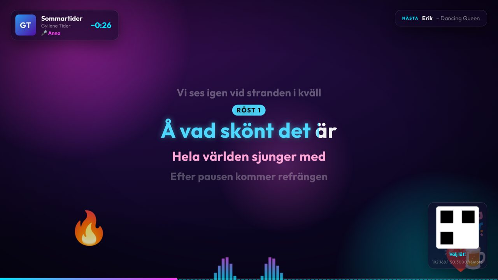
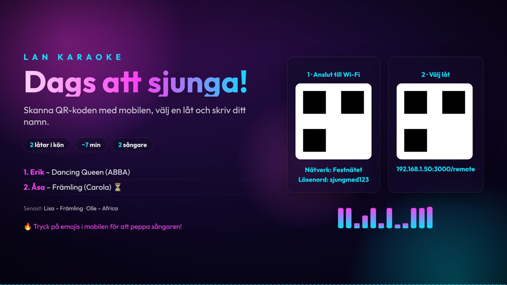
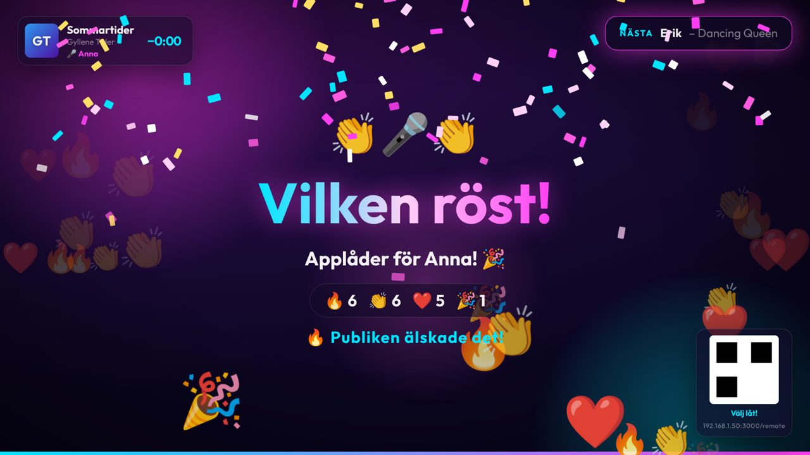
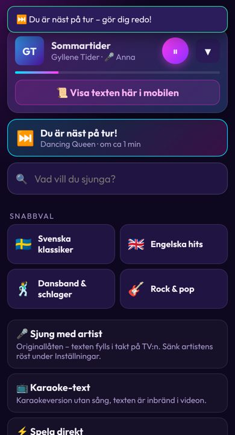
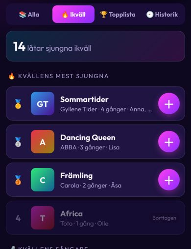
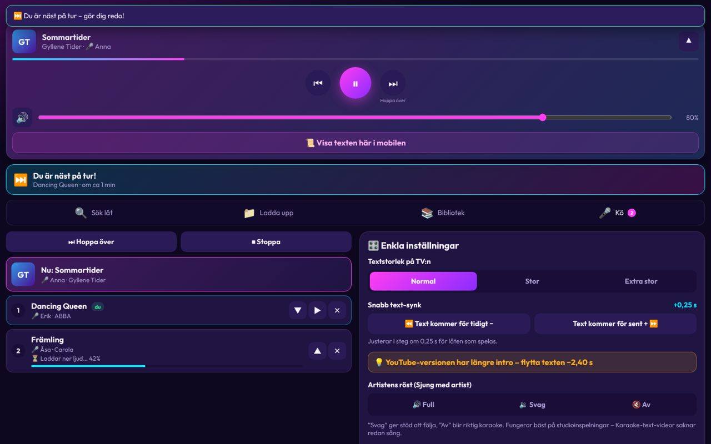

# 🎤 LAN Karaoke

**Karaoke för hela sällskapet: TV:n är scenen och mobilerna är fjärrkontrollen.**

Ett självhostat karaokesystem för hemmafesten. En liten dator kopplas till TV:n, och gästerna skannar en QR-kod, söker låtar, ställer sig i kön och peppar varandra med emojis. Allt är på svenska och fungerar i det lokala nätverket, utan konton och utan appar att installera.



---

## ✨ Funktioner

### 📺 På TV:n
- **Låttext som fylls i takt** med musiken, ord för ord, med nedräkning 3-2-1 inför varje vers
- **Intro-kort** som visar vem som sjunger härnäst
- **Emoji-reaktioner** från publiken (🔥 👏 ❤️ 🎉 🍺 😂) och en **applådmätare** när låten är slut
- **Konfetti och fanfar** när en låt sjungits klart
- **Duetter**: rader märkta med `M:`/`F:` eller `Alla:` färgas per röst
- **Fyra teman**: Neon Party, Midnattsblå, Guld/Schlager (med discokula ✨) och Musikvideo i bakgrunden
- **Vänteläge** med QR-koder för Wi-Fi och appen, kön, senast sjungna och tips

| Vänteläge | Firande |
|---|---|
|  |  |

### 📱 I mobilen (gäster)
- **Ett sökfält för allt**. Sökningen startar medan man skriver och visar tre sorters träffar:
  - ⚡ **Spela direkt**: låtar som redan finns på datorn
  - 🎤 **Sjung med artist**: originallåten med synkad text
  - 📺 **Karaoke-text**: karaokevideor utan sång
- **＋ direkt i kön** med ett tryck
- **🎲 Överraska mig**: slumpar en låt. Låtar du valt bort visas inte igen på en timme.
- **"Min tur"**: "Du är 3:e i kön – om ca 9 min", och telefonen vibrerar när det är din tur
- **Texten i mobilen** för den som sjunger vänd mot publiken
- **Artistens röst**: Full, Svag eller Av
- **Topplistor**: kvällens och alla tiders mest sjungna låtar och flitigaste sångare
- **Snabb text-synk** om texten kommer för tidigt eller för sent

| Sök | Topplista |
|---|---|
|  |  |

### 🎛️ Värdpanel (på datorn)
- Alla avancerade inställningar: tonartsändring, tempo, ljudnivå, EQ, rättvis kö och värdläge
- Låt- och textredigering med **tap-synk**
- Systemkontroll: disk, ljudutgång/HDMI, YouTube-cookies, cache, omstart
- **Uppdatering från GitHub** med ett klick, med säkerhetskopia och möjlighet att ångra



### 🧠 Funktioner i bakgrunden
- **Smart textsökning** för svenska och engelska låtar (hanterar å/ä/ö, "Remastered", "Live" med mera)
- **Jämn ljudnivå** mellan alla låtar (EBU R128)
- **Rättvis kö**: ingen får sin andra låt innan alla fått sin första
- **Kön överlever omstart**, och avbrutna nedladdningar fortsätter
- **Watchdog**: om TV-bilden fryser startas webbläsaren om automatiskt

---

## 🧰 Det här behövs

| Del | Rekommendation |
|---|---|
| Dator | Mini-PC med Intel Celeron/Pentium och 4–8 GB RAM (testad på MSI Cubi N 8GL) |
| System | Ubuntu 22.04, 24.04 eller 26.04 |
| Bild och ljud | HDMI till TV:n. Ljudet går från TV:n till högtalaren. |
| Mikrofoner | Kopplade direkt till högtalaren eller en mixer, så att sången inte får fördröjning |
| Nätverk | Wi-Fi som gästerna kan ansluta till, och internet för att hämta låtar |

---

## 🚀 Installation

```bash
git clone https://github.com/SNAPZ01/lan-karaoke.git
cd lan-karaoke
sudo bash setup-ubuntu.sh
```

Installern gör det här:
- Installerar Node.js, ffmpeg, yt-dlp och Chromium
- Frågar efter **PIN** (valfritt), **Wi-Fi** för QR-koden och **automatisk inloggning**
- Startar servern automatiskt och TV-vyn i helskärm när datorn startar

Starta om datorn när installern är klar. TV:n visar sedan väntelägets QR-kod, och festen kan börja. 🎉

---

## 🎶 Använda systemet

| Vem | Var | Adress |
|---|---|---|
| 📺 TV:n | Startar automatiskt | `http://localhost:3000/tv` |
| 📱 Gäster | Skanna QR-koden på TV:n | `http://<datorns-IP>:3000/remote` |
| 🎛️ Värd | Appen **Karaoke Värdpanel** på datorn | `http://localhost:3000/host` |

> Byt mellan TV-vyn och värdpanelen med **Alt+Tab**. Från en annan dator öppnas värdpanelen med `http://<IP>:3000/host` och din PIN.

---

## ⚙️ Inställningar

Inställningarna ligger i `/etc/default/lan-karaoke`. Starta om tjänsten efter en ändring:

```bash
sudo systemctl restart lan-karaoke
```

| Inställning | Betydelse |
|---|---|
| `KARAOKE_PIN` | PIN för värdpanelen från andra enheter (och värdläge) |
| `WIFI_SSID`, `WIFI_PASSWORD` | Wi-Fi-QR på TV:n |
| `WIFI_SHOW_PASSWORD` | `0` = visa bara QR-koden, inte lösenordet i text |
| `UPDATE_REPO` | GitHub-repo för uppdateringar, t.ex. `SNAPZ01/lan-karaoke` |
| `UPDATE_TOKEN` | Bara om repot är privat |
| `CACHE_MAX_GB` | Max utrymme för karaoke-videor (standard 10) |
| `COVERS_ONLINE` | `0` = hämta inga albumomslag från internet |

---

## 🔄 Uppdatera

**Från värdpanelen:** 🔄 Uppdatering → *Sök efter uppdatering* → *Installera*.
Gick något fel? Tryck *Återställ föregående version*.

Låtar, kö, historik och inställningar påverkas aldrig av en uppdatering.

---

## 🩺 Felsökning

| Problem | Lösning |
|---|---|
| Inget ljud | Värdpanelen → Systemkontroll → **Aktivera HDMI-ljud** |
| Gästerna når inte sidan | Kontrollera att mobilen är på samma Wi-Fi som datorn |
| "YouTube kräver inloggning" | Ladda upp en `cookies.txt` i värdpanelen |
| Texten kommer fel | Använd **Snabb text-synk** och spara i värdpanelen |
| Videon hackar | Ställ datorns upplösning på 1920×1080 i stället för 4K |
| Något annat | `journalctl -u lan-karaoke -n 100 --no-pager` |

---

## 🏗️ För utvecklare

```bash
npm install
npm run dev     # http://localhost:3000/tv
npm test        # enhetstester (node:test)
```

Arkitektur, moduler och tekniska beslut beskrivs i **[docs/TEKNIK.md](docs/TEKNIK.md)**.

---

## 📜 Licenser och tack

- Låttexter från [LRCLIB](https://lrclib.net), en öppen databas med synkade låttexter
- Nedladdning via [yt-dlp](https://github.com/yt-dlp/yt-dlp)
- Typsnittet [Outfit](https://fonts.google.com/specimen/Outfit) under SIL Open Font License (se `public/fonts/Outfit-OFL.txt`)
- Albumomslag via iTunes Search API

> ⚠️ Systemet är tänkt för privat bruk hemma. Respektera upphovsrätten för musik och videor du laddar ner.
